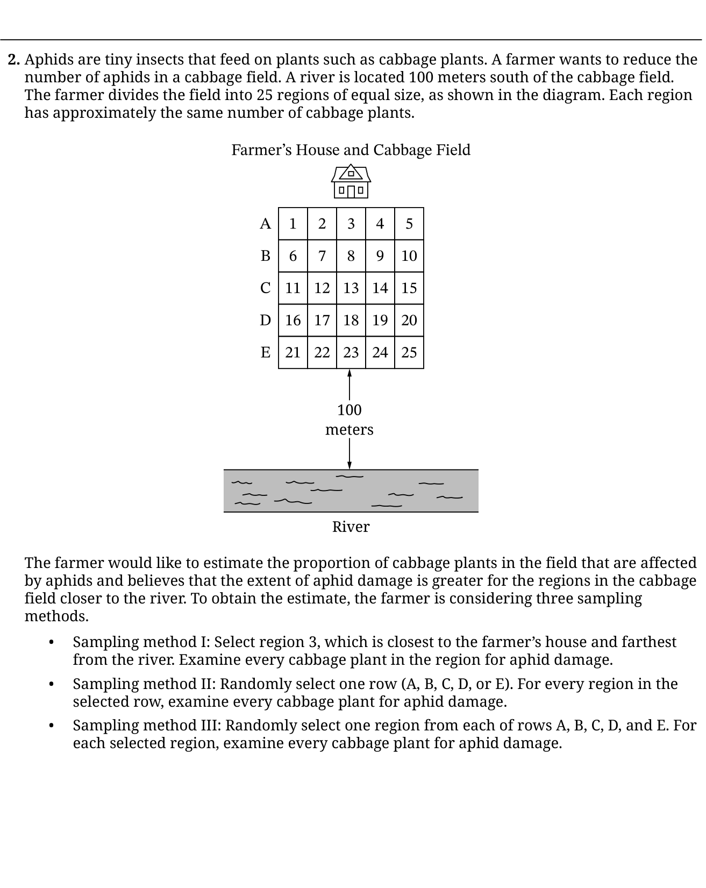
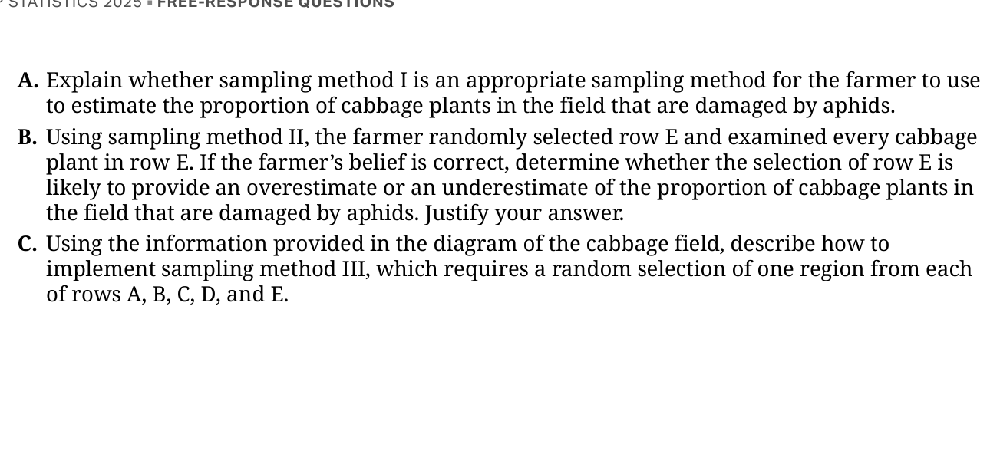

# Topic 1.11 Random Sampling

Suppose a school wants to estimate the **mean one-way travel time** among all its students. Asking only people who happen to arrive early may produce a convenient list of times, but it gives many other students no chance to be included. A **sampling design** specifies exactly how people enter the sample *before* their travel times are examined. This chapter compares five ways to select observations and explains what each design achieves.

The essential questions are: Which groups should be created before drawing? **What exactly is selected at random?** Who is measured after selection? Those choices determine whether the design is a simple random, stratified, cluster, or systematic sample. We will also distinguish drawing **with** and **without replacement**.

## 1. The sampling frame and the random mechanism {#frame-111}

Start with three distinct objects. The **target population** is the group the investigation is about. The **sampling frame** is the list, map, or other mechanism through which eligible units can be reached. The **sample** is the subset of observational units ultimately measured. For a current school enrollment study, the frame might be the official enrollment roster. If the roster excludes some students, even a perfectly random selection from that frame will not reach the missing students.

Give every eligible student a unique roster number. A reproducible selection procedure must state the possible numbers, the random device, how many are selected, what happens to repeats, and how the corresponding students are contacted. A random digit **by itself** does not identify a complete sampling plan.

**Random selection is not random assignment.** In a survey, the researcher selects people to *observe*. In an experiment, a researcher may assign treatments *after* people enter the study. Selecting a random sample can strengthen population generalization; assigning treatments by chance is a different step that helps assess causation. A larger nonrandom sample cannot replace a sound selection mechanism.

## 2. Replacement changes the experiment {#replacement-111}

A draw **without replacement** removes the selected individual from the pool for the rest of the sample: no individual appears twice. A draw **with replacement** returns that individual to the pool before the next draw, so a repeated ID is possible. The latter is often used when a random mechanism repeatedly samples from the same list; it is **not** a sample of distinct people when a label repeats.

For example, randomly select three slips labelled A, B, C from a bag. Without replacement, three draws must produce all three labels in some order. With replacement, a valid sequence might be A, A, C. A previously selected individual does not become less likely on the next draw when every draw begins with the same bag.

For a uniform independent draw **with replacement** from $N$ labelled units, the chance that the next draw repeats a particular previously selected unit is

$$
P(\text{next draw is that unit})=\frac{1}{N}.
$$

::: {.callout-note collapse="true"}
## Optional derivation: why $1/N$?

A properly mixed pool has $N$ equally likely labels on *each* draw. Exactly one label equals the specified earlier label, so the favorable fraction is $1/N$. The calculation assumes the pool is restored and each new draw is uniform. Without replacement, a just-selected label has probability zero of reappearing.
:::

**Checkpoint.** If two samples each contain six draws and only one includes the same person twice, which sample definitely used replacement? The duplicate could occur only when replacement was permitted; a sample with no duplicates **might still** have used replacement.

## 3. Simple random sampling: equal chances for whole samples {#srs-111}

A **simple random sample (SRS) of size $n$** from a population of $N$ distinct units assigns *every possible group of $n$ different units* the **same probability**. The equality concerns the possible **sets**, not merely the chance each person has of being selected. One familiar implementation is to generate $n$ distinct roster numbers uniformly at random, rejecting repeated numbers until the required number of unique students is obtained.

For example, among six students A through F, an SRS of two could yield AB, AC, AD, AE, AF, BC, BD, BE, BF, CD, CE, CF, DE, DF, or EF. There are 15 possible pairs, and a proper SRS gives **each pair** probability $1/15$. Giving each individual a one-third chance of inclusion is necessary here, but by itself does not prove that all fifteen pairs have equal chances.

If the mechanism is an SRS without replacement and $0\le n\le N$, the number of possible unordered groups and each particular group's probability are

$$
\binom{N}{n}=\frac{N!}{n!(N-n)!},\qquad
P(\text{particular SRS group})=\frac{1}{\binom{N}{n}}.
$$

::: {.callout-note collapse="true"}
## Optional derivation: counting equally likely samples

There are $N(N-1)\cdots(N-n+1)$ **ordered** draws without replacement. Each unordered set is counted $n!$ times, once per order. Dividing gives $\binom{N}{n}$. Because each ordered sequence has equal probability, each unordered set also does. The reciprocal is the probability of any particular group. This counting derivation is enrichment; the AP skill is recognizing and implementing an SRS correctly.
:::

**Worked example.** A club has 20 members. To select an SRS of five, label members 01 through 20; use a random-integer generator for five *distinct* numbers from 01–20; contact the members attached to those numbers. Accepting duplicates as additional distinct people, or taking the first five who respond to an open invitation, would **not** be that SRS.

## 4. Stratified, cluster, and systematic designs {#designs-111}

### Stratified random sample: sample **inside every group** {#stratified-111}

Divide the population into **nonoverlapping strata** whose members share a relevant characteristic: grade, geographic region, or another factor related to the response. Select an **SRS within each stratum**, then pool those selections. Every stratum contributes some observations. If commute time differs by grade, taking two students at random from each of three grades ensures that all three grades appear in the sample.

Strata are often chosen to be **relatively homogeneous within each stratum** on a characteristic relevant to the outcome. This design can provide more stable estimates and ensures subgroup coverage. Sampling fractions need not be equal; if some strata are oversampled, a simple unweighted sample mean may not represent the population mean. Appropriate population weights then matter.

### Cluster random sample: sample **groups, then everyone inside** {#cluster-111}

Divide the population into **clusters**—naturally occurring groups such as classrooms, city blocks, or advisory groups. Choose an **SRS of clusters**, then measure **all individuals in every selected cluster**. Each cluster ideally represents a miniature mix of the full population, with clusters broadly comparable. Sampling one randomly chosen advisory group is cheaper than finding scattered students across the entire campus.

Do not confuse a cluster sample with a stratified sample. A stratified plan draws some individuals **from every stratum**; a one-stage cluster plan chooses **some clusters and includes everyone in those chosen groups**. A plan that randomly chooses clusters *and then samples within them* is a **two-stage cluster design**, an additional technique, not the one-stage definition in this topic.

### Systematic random sample: a random start, then fixed steps {#systematic-111}

Arrange the $N$ units in a meaningful list, randomly select the starting position among the first $k$ positions, and take every $k$-th unit after that. When $N$ is divisible by the intended sample size $n$, a common step size is

$$
k=\frac{N}{n}.
$$

::: {.callout-note collapse="true"}
## Why this choice of interval? — Design rationale

For an ordered list of $N$ entries, choosing every $k$-th entry yields approximately $N/k$ selections. When $N$ divides evenly into $n$ groups, choosing $k=N/n$ and a start among $1,\ldots,k$ gives exactly $n$ positions. This is a sampling-design choice, not a universal formula when $N/n$ is nonintegral or the list has a different structure.
:::

For $N=36$ and $n=6$, use $k=6$. If a fair random start is 4, the selected roster positions are **4, 10, 16, 22, 28, and 34**. Picking position 4 deliberately every time is *not* a random start. An ordered roster with an underlying cycle of six could cause this design to select a very unrepresentative mix even though the start was random.

## 5. Interactive sampling laboratory {#lab-111}

Explore a model school with **36 students** in six advisory groups of six. Grade A, B, and C students appear twice in each advisory group. The figures inside each cell are one-way travel times, measured in minutes. The population mean is **17 minutes**.

Before drawing, **predict the representation**: Which method guarantees that all three grades contribute? With this particular roster order, which method picks six people from just one grade? Which method measures everybody in one selected advisory group?

```{=html}
<div class="sampling111" data-sampling111>
  <div class="sampling111-controls">
    <label>Sampling method
      <select data-s111-method>
        <option value="srs">Simple random sample (six distinct students)</option>
        <option value="stratified">Stratified: two from each grade</option>
        <option value="cluster">Cluster: one entire advisory group</option>
        <option value="systematic">Systematic: random start, every sixth student</option>
        <option value="replacement">Six independent draws with replacement</option>
      </select>
    </label>
    <label>Reproducible random seed
      <input data-s111-seed type="number" min="1" max="999999" step="1" value="1729">
    </label>
  </div>
  <div class="sampling111-actions">
    <button type="button" data-s111-step>Reveal next selection</button>
    <button type="button" data-s111-all>Show entire sample</button>
    <button type="button" data-s111-reset>Reset experiment</button>
  </div>
  <p data-s111-status role="status" aria-live="polite">Ready. Choose a method, predict the result, and reveal the selections.</p>
  <div data-s111-grid class="sampling111-grid" role="list" aria-label="36 labelled population units, organised into six advisory groups"></div>
  <p data-s111-summary aria-live="polite">All 36 students are available.</p>
  <div data-s111-explanation class="sampling111-explanation">Every cell records its roster number, advisory group, grade, and travel time. Selection highlights will also be described in the text summary.</div>
</div>
```

**Read the result, not just the colors.** The tool reports the actual selected IDs, number of *different students*, grade representation, and sample mean. With replacement, repeated draws show a visible **×2 draws** marker (or larger count) on the affected student, as well as repeated IDs in the text summary. Try changing the seed and notice that an SRS does not guarantee identical grade counts; stratification does. Each advisory group deliberately contains a grade mix, so a one-advisory cluster sample does include all three grades. In contrast, these roster positions repeat the same grade pattern every six entries: the systematic sample selects only one grade. This is a feature of **this roster order**, illustrating why order should be inspected before systematic sampling.

A random sample need not resemble the population perfectly in one draw. Repeating the process can produce different answers through **sampling variability**. That is not itself evidence that the random-number generator is flawed. A bad frame or measurement process can introduce a different problem, **bias**, even with a very large sample; Topic 1.12 develops these distinctions.

**Static example to check by hand.** For a systematic design with start 4 and interval 6, select IDs 04, 10, 16, 22, 28, 34. These are all Grade A in this roster pattern. Their travel times are 10, 12, 14, 10, 12, 14 minutes, so their mean is $72/6=12$ minutes, below the population mean of 17. Another random start can give a different grade and a different result. **A disappointing single sample does not establish that the sample mean is biased over repeated random starts.** In fact, because the starting position is uniformly chosen from 1 through 6, this particular systematic design produces the following six equally likely sample means:

| Random starting position | Grade of all six selected students | Sample mean (minutes) |
|---:|:---:|---:|
| 1 | A | 10 |
| 2 | B | 16 |
| 3 | C | 22 |
| 4 | A | 12 |
| 5 | B | 18 |
| 6 | C | 24 |

Across repeated *fairly randomized starts*, the average of these possible sample means is $(10+16+22+12+18+24)/6=17$ minutes—the actual population mean. Thus the estimator is **unbiased in this example**, even though a single systematic sample could be as low as 10 or as high as 24 minutes. **Lack of bias does not imply low variability or a representative individual sample.** The periodic roster produces high sampling variability because it selects only one grade each time.

::: {.callout-note collapse="true"}
## Optional derivation: why this random-start mean is unbiased here

Let $x_1,\ldots,x_{36}$ denote the 36 travel times. If start $r\in\{1,\ldots,6\}$ is equally likely, the corresponding sample mean is $\bar{x}_r=\frac{1}{6}\sum_{j=0}^{5}x_{r+6j}$. Its expected value over the six starting positions is

$$
\begin{aligned}
E(\bar{X})
&=\frac{1}{6}\sum_{r=1}^{6}\bar{x}_r\\
&=\frac{1}{6}\cdot\frac{1}{6}\sum_{r=1}^{6}\sum_{j=0}^{5}x_{r+6j}\\
&=\frac{1}{36}\sum_{i=1}^{36}x_i=\mu=17\text{ minutes}.
\end{aligned}
$$

Each of the 36 population members appears once across the six possible starting positions. This proof depends on a **uniform random start** and an evenly divisible list; it does not claim that systematic samples have the same variability as SRS, nor that a particular sample must be typical. Expected-value algebra is optional enrichment for this topic.
:::

## 6. Decide which sampling design fits the question {#choice-111}

| Need or constraint | Often a defensible choice | Why |
|:--|:--|:--|
| A complete numbered roster and feasible individual contact | SRS | Every fixed-size group has equal chance. |
| Reliable estimates for each grade, including a small grade | Stratified sample | Randomly sample within **each** relevant grade; consider appropriate weights for overall estimates. |
| Visiting individuals is costly, but complete classrooms are easy to survey | Cluster sample | Randomly choose classrooms and measure everyone in selected classrooms; clustering can increase uncertainty if classmates resemble one another. |
| Units are listed in a sensible order without an outcome-related repeating cycle | Systematic sample | A random start plus fixed interval is efficient to implement. |

**Ethical collection** still matters after selection: protect responses, invite participation appropriately, use clear questions and respect refusals. Do not use a random-number generator as an excuse to ignore consent or confidentiality. A design should fit its research question, population, logistical limitations, and data quality—not merely have a random component somewhere.

**Quick synthesis.** An SRS randomizes *individual groups of fixed size*; a stratified design samples *within every stratum*; a cluster design samples *entire randomly chosen groups*; a systematic design selects *periodic list positions after a random start*. Replacement changes whether a unit can appear again. Explain **who** is selected, **how**, and **why** the design serves the investigator’s question.

## 7. Released AP examination example {#exam-111}

The 2025 AP Statistics **Question 2** considers an aphid survey in a cabbage field divided into 25 regions arranged in five rows. Examine the original released question alongside the explanation.

```{=html}
<div class="exam-source sampling111-source">
  <figure><a class="exam-enlarge" href="assets/exam/ap25-q2-stem.png" aria-label="Enlarge 2025 AP Statistics Question 2 diagram and sampling methods"></a><figcaption>College Board · 2025 AP Statistics · Question 2, problem and diagram. Select to enlarge.</figcaption></figure>
  <figure><a class="exam-enlarge" href="assets/exam/ap25-q2-parts.png" aria-label="Enlarge 2025 AP Statistics Question 2 parts A through C"></a><figcaption>College Board · 2025 AP Statistics · Question 2, parts A–C. Select to enlarge.</figcaption></figure>
</div>
```

**Part A.** Choosing region 3 merely because it is closest to the farmer's house is **convenience sampling**; it is not a defensible random representation of the field. If damage is related to river distance, the estimate could be systematically low.

**Part B.** Randomly choosing a row and studying every plant in that row is a **cluster sample of rows**. In the reported draw, row E is nearest the river. Under the farmer's stated hypothesis that aphid damage is higher nearer the river, **that selected row is likely to give an overestimate** of the damage proportion for the whole field. Random cluster selection does not make the resulting single cluster a perfect miniature of the field.

**Part C.** To implement the proposed sampling plan, form five strata (the five rows). For each row separately, number its five regions, use a uniform random integer from 1 to 5 (or equivalent fair slips), and select the corresponding region. Repeat independently for each row. Examine every cabbage plant in each chosen region. This selects exactly **one region from each row**, not five freely selected regions from the whole field. It is a stratified random selection of regions followed by complete measurement within selected regions.

<details><summary>Accessible description of the released question</summary><p>The field contains five rows A–E of five numbered regions each; row A is farthest from the river and row E closest. Method I always examines region 3. Method II randomly chooses one entire row. Method III independently randomly chooses one region from each row. The question asks which procedures can represent the field and how to implement the third method accurately.</p></details>

## Practice {#practice-111}

::: {.original-practice-host data-original-practice="1.11"}
:::

<details class="lesson-sources sampling111-sources"><summary>Sources</summary><p>College Board, <a href="https://apcentral.collegeboard.org/media/pdf/ap-statistics-course-and-exam-description-effective-fall-2026.pdf">AP Statistics Course and Exam Description (Fall 2026)</a>, Topic 1.11, pp. 48–49; <a href="https://apcentral.collegeboard.org/media/pdf/ap25-frq-statistics.pdf">2025 released free-response questions</a>, Question 2; and <a href="https://apcentral.collegeboard.org/media/pdf/ap25-sg-statistics.pdf">2025 scoring guidelines</a>, Question 2. The sampling-laboratory data and original exercises are documented in this topic's editable source directory.</p></details>
