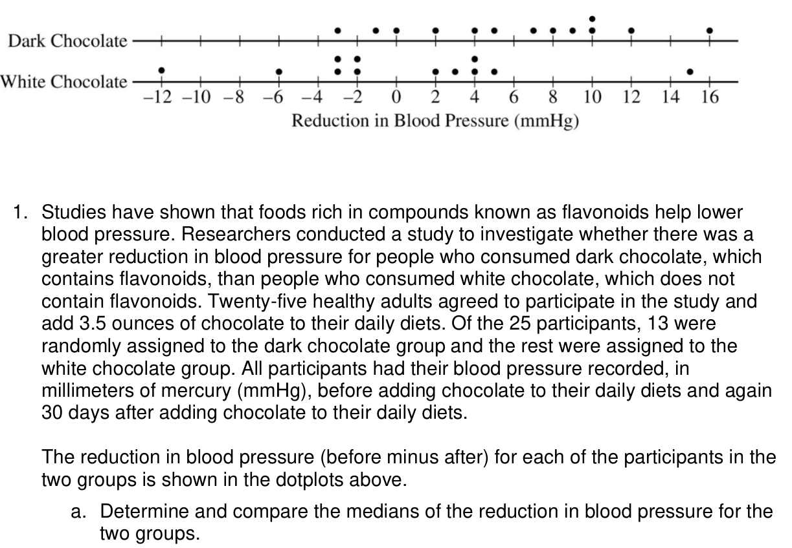

<figure class="exam-source" data-exam-id="ap22-chocolate">

<figcaption>2022 AP Statistics question · College Board AP Daily Session 4 (2023) · <a href="https://apclassroom.collegeboard.org/video-resources/AP_Statistics/_Session_4_Statistics_2023_AP_Daily_Practice_Sessions.pdf">College Board</a> · © College Board</figcaption>

Read the question description

The study assigns 13 adults to dark chocolate and 12 to white chocolate. The dotplots display before-minus-after blood-pressure reductions in mmHg. Compare the medians. The values are listed in the solution below.

</figure>
