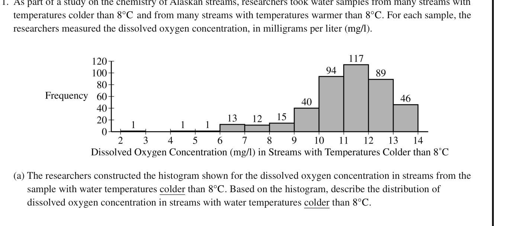

<figure class="exam-source" data-exam-id="ap23-q1a">

<figcaption>2023 AP Statistics, Question 1(a) · <a href="https://apcentral.collegeboard.org/media/pdf/ap23-frq-statistics.pdf">College Board</a> · © College Board</figcaption>

Read the question description

Describe the distribution of dissolved oxygen in streams colder than 8°C. The histogram frequencies are also provided in the lesson below.

</figure>
