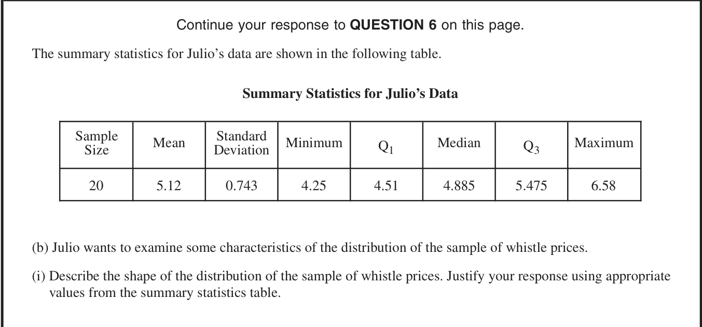
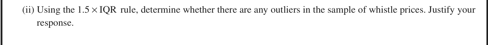

<figure class="exam-source" data-exam-id="ap24-q6b-summary">

<figcaption>2024 AP Statistics, Question 6(b)(i) · <a href="https://apcentral.collegeboard.org/media/pdf/ap24-frq-statistics.pdf">College Board</a> · © College Board</figcaption>

Read the question description

For 20 whistle prices, the mean is 5.12 dollars, SD 0.743 dollars, minimum 4.25 dollars, first quartile 4.51 dollars, median 4.885 dollars, third quartile 5.475 dollars and maximum 6.58 dollars. Use these summaries to describe the shape.

</figure>

<figure class="exam-source" data-exam-id="ap24-q6b-outliers">

<figcaption>2024 AP Statistics, Question 6(b)(ii) · <a href="https://apcentral.collegeboard.org/media/pdf/ap24-frq-statistics.pdf">College Board</a> · © College Board</figcaption>

Read the question description

Determine whether the whistle prices contain outliers using the 1.5-IQR rule, and show the calculations.

</figure>
