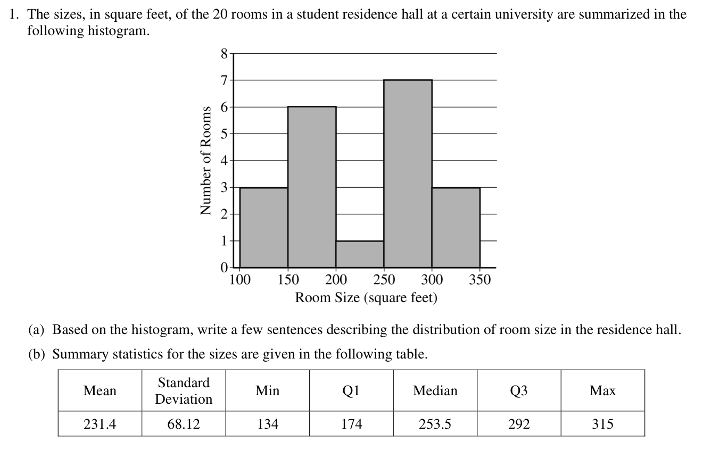
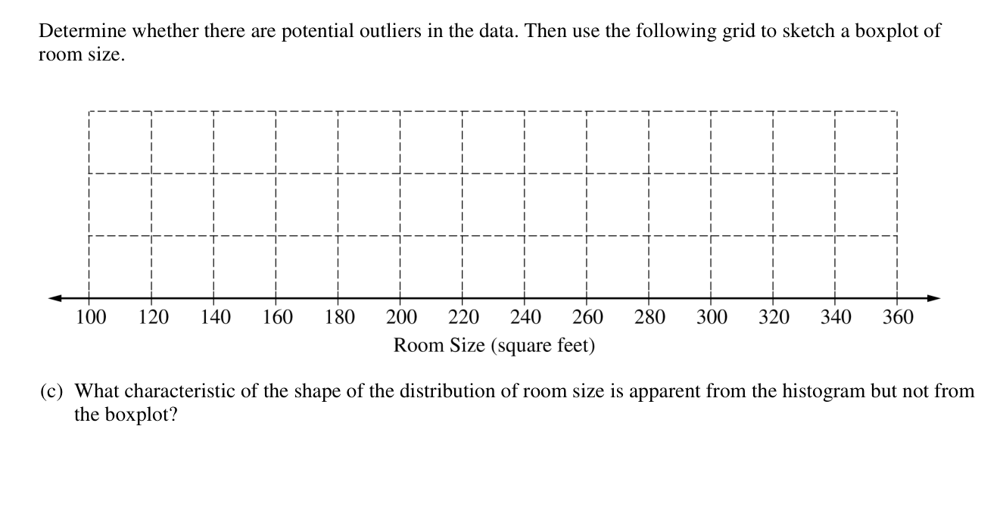

<figure class="exam-source" data-exam-id="ap19-q1-data">

<figcaption>2019 AP Statistics, Question 1: room sizes · <a href="https://apstudents.collegeboard.org/ap/2019-05/ap19-frq-statistics.pdf">College Board</a> · © College Board</figcaption>

Read the question description

For 20 rooms, the five-number summary in square feet is 134, 174, 253.5, 292, 315. The mean is 231.4 and the SD is 68.12. Describe the distribution using the histogram.

</figure>

<figure class="exam-source" data-exam-id="ap19-q1-bc">

<figcaption>2019 AP Statistics, Question 1(b)–(c) · <a href="https://apstudents.collegeboard.org/ap/2019-05/ap19-frq-statistics.pdf">College Board</a> · © College Board</figcaption>

Read the question description

Determine whether the data contain outliers and construct a boxplot. Identify a feature visible in the histogram that the boxplot does not show.

</figure>
