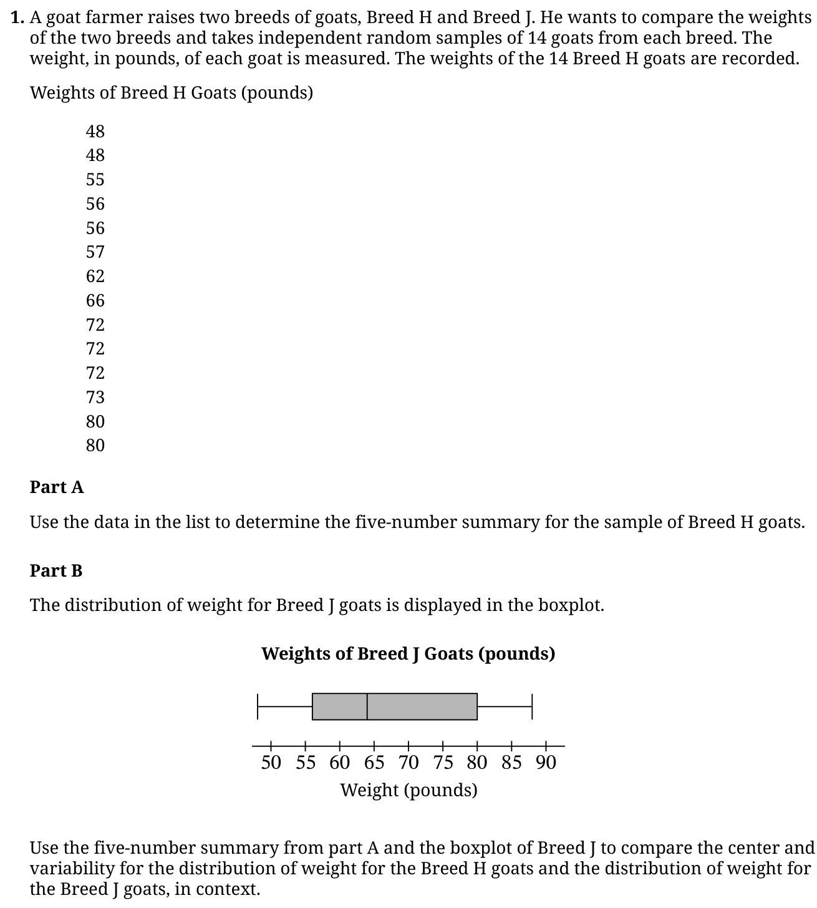
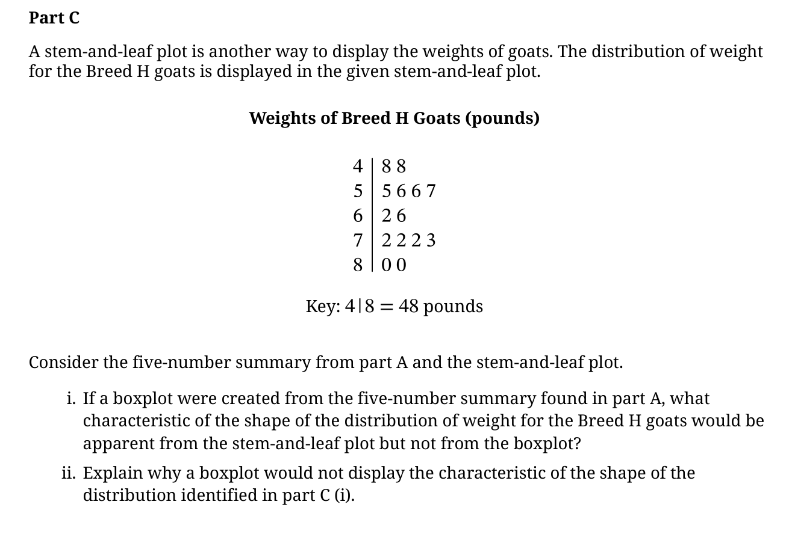

<figure class="exam-source" data-exam-id="ap26-q1-ab">

<figcaption>2026 AP Statistics, Question 1(a)–(b) · <a href="https://apcentral.collegeboard.org/media/pdf/ap26-frq-statistics.pdf">College Board</a> · © College Board</figcaption>

Read the question description

The sampled Breed H goat weights in pounds are 48, 48, 55, 56, 56, 57, 62, 66, 72, 72, 72, 73, 80, 80. Find their five-number summary and compare their median and variability with Breed J. The Breed J boxplot has an approximate five-number summary of 48, 56, 64, 80, 88.

</figure>

<figure class="exam-source" data-exam-id="ap26-q1-c">

<figcaption>2026 AP Statistics, Question 1(c) · <a href="https://apcentral.collegeboard.org/media/pdf/ap26-frq-statistics.pdf">College Board</a> · © College Board</figcaption>

Read the question description

The Breed H stemplot has stems 4 through 8 and leaves 8 8; 5 6 6 7; 2 6; 2 2 2 3; 0 0. Describe a feature shown by the stemplot but not by a boxplot.

</figure>
